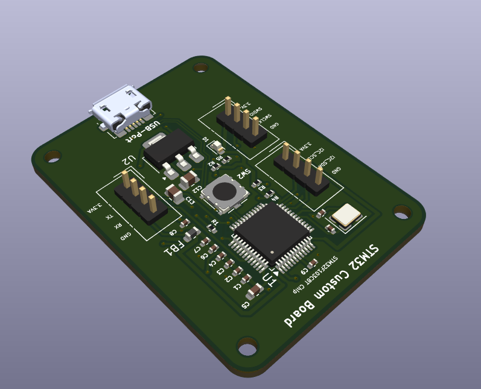
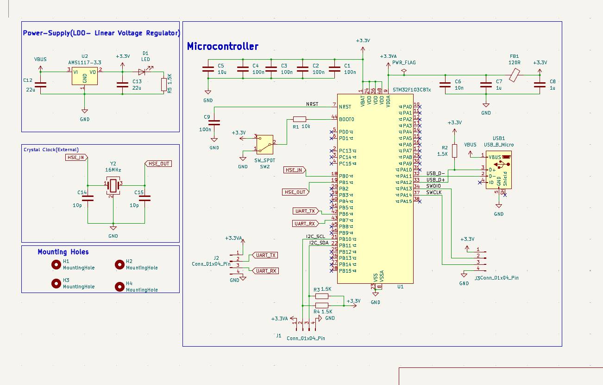
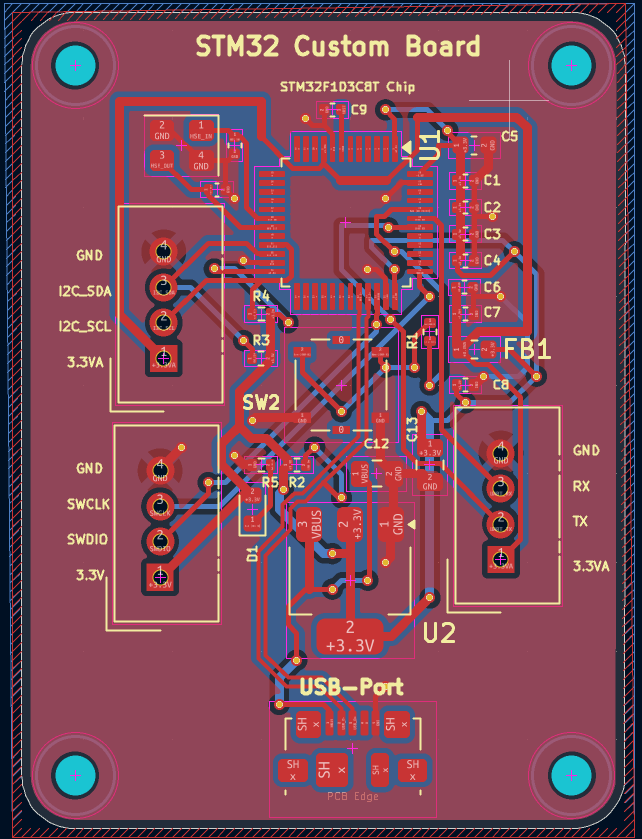
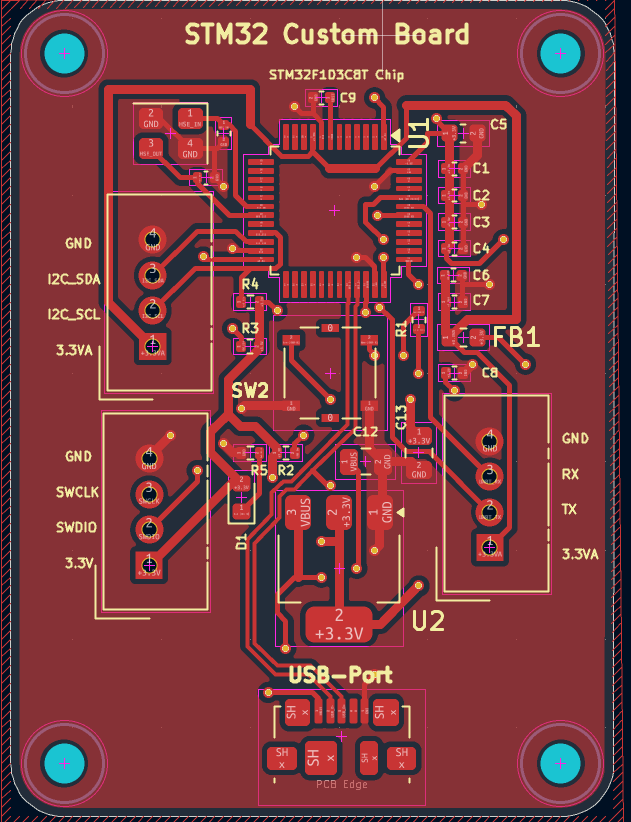
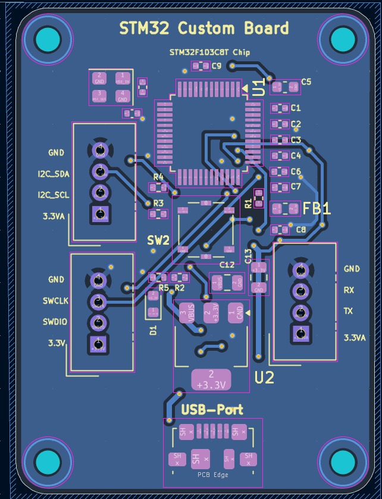
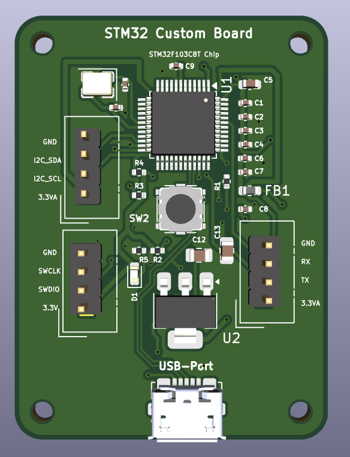
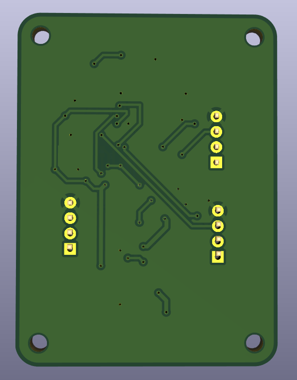
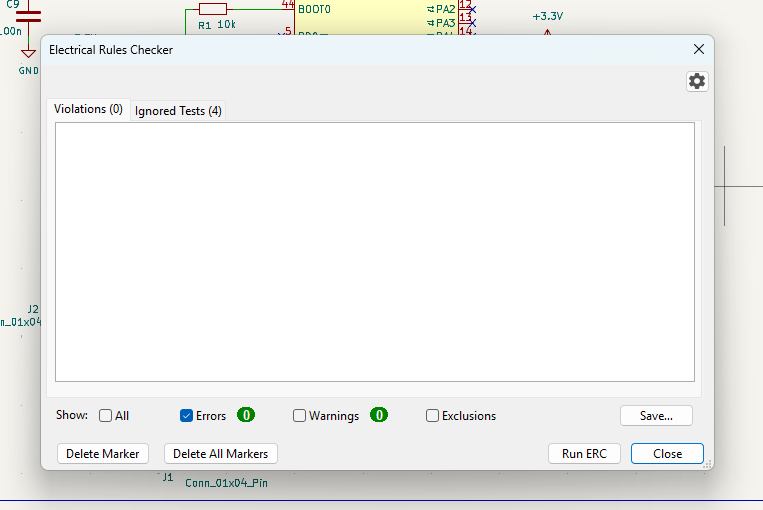
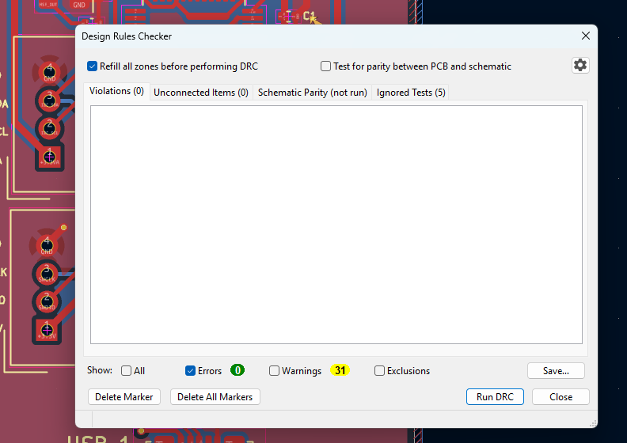

# Custom STM32 PCB Board

A custom-designed STM32 development board built around the **STM32F103C8T6** microcontroller. The project includes the KiCad schematic, PCB layout, component 3D models, and design-review images.

<p align="center">
  
</p>

## Project overview

This project is a custom PCB implementation of an STM32F103-based development board. It brings together the microcontroller, external clock circuit, USB connectivity, regulated 3.3 V power, reset/boot support, and breakout headers for external connections.

The board is intended as a hardware platform for embedded development and experimentation with the STM32F1 family.

## Main features

- **STM32F103C8Tx** microcontroller.
- External **16 MHz** crystal clock circuit.
- **Micro-USB** connector.
- **AMS1117-3.3** linear voltage regulator.
- USB data-line connections and supporting resistors.
- Reset and boot configuration circuitry.
- Breakout headers for power, UART, SWD, and general-purpose signals.
- Status LED and mounting holes.

The exact pin mapping and component values should be taken from the schematic.

## Hardware overview

| Component / circuit | Purpose |
|---|---|
| STM32F103C8Tx | Main 32-bit ARM Cortex-M3 microcontroller |
| 16 MHz crystal (Y2) | External high-speed clock source |
| AMS1117-3.3 (U2) | 3.3 V linear voltage regulation |
| Micro-USB connector (USB1) | USB connection and VBUS input |
| 4-pin headers (J1, J2, J3) | Breakout connections for power and signals |
| SW_SPDT (SW2) | Board configuration / switching |
| LED (D1) | Visual status indication |
| FB1 | Ferrite bead for supply filtering |
| Mounting holes (H1–H4) | Mechanical mounting |

## Design images

### Schematic

<p align="center">
  
</p>

### PCB layout

**Front and back copper layers**

<p align="center">
  
</p>

**Front copper**

<p align="center">
  
</p>

**Back copper**

<p align="center">
  
</p>

### 3D PCB views

<p align="center">
  
</p>

<p align="center">
  
</p>

<p align="center">
  
</p>

## Schematic overview

The schematic is organized around these functional sections:

1. **Microcontroller:** STM32F103C8Tx with its power, ground, reset, and boot connections.
2. **Clock:** 16 MHz external crystal and associated load capacitors.
3. **Power:** USB VBUS input feeding the AMS1117-3.3 regulator, with decoupling and filtering components.
4. **USB:** Micro-USB connector and USB data-line connections.
5. **Debug and expansion:** Header connections for SWD, UART, power, and other signals.
6. **User interface:** LED and board configuration switch.

<p align="center">
  
</p>

## Design rule checks

The supplied KiCad screenshots show the following results at the time they were captured:

| Check | Reported result |
|---|---:|
| Electrical Rules Checker (ERC) | 0 violations, 0 warnings |
| Design Rules Checker (DRC) | 0 violations, 0 unconnected items, 31 warnings |

The DRC screenshot also shows 5 ignored tests. These screenshots are a record of a particular design-check run, not a guarantee that the board is fabrication-ready. Review all warnings and rerun ERC/DRC with the intended fabrication constraints before manufacturing.

**ERC result**

<p align="center">
  
</p>

**DRC result**

<p align="center">
  
</p>

## Repository contents

```text
Custom-STM32-PCB/
├── STM32-Board.kicad_pro       # KiCad project
├── STM32-Board.kicad_sch       # Schematic
├── STM32-Board.kicad_pcb       # PCB layout
├── Schema-PDF/
│   └── STM32-Board.pdf         # Schematic exported as PDF
├── Pictures/
│   ├── Schema.png
│   ├── Front-Copper.png
│   ├── Back-Copper.png
│   ├── Front-&-Back-Copper.png
│   ├── Top-View.png
│   ├── Front-Diagnol.png
│   ├── Back Diagnol.png
│   ├── Bottom.png
│   ├── ERC.png
│   └── DRC.png
├── Micro-USB-Custom/           # Micro-USB connector 3D model
└── Piin_Header_3D_Model/       # Pin-header 3D model
```

## Opening the KiCad project

1. Install [KiCad](https://www.kicad.org/).
2. Clone or download this repository.
3. Open `STM32-Board.kicad_pro`.
4. Open the schematic or PCB editor to inspect or modify the design.
5. Keep the 3D model folders in their repository-relative locations so the board's 3D viewer can resolve the models.

If a 3D model is missing, review the model path in the footprint properties and update it to the correct local or project-relative path.

## Programming and development

The repository contains the hardware design files, but does not include firmware or a software project. To use the board in an embedded application, add firmware built with a suitable STM32 toolchain, such as STM32CubeIDE or an equivalent ARM embedded development environment.

The board exposes header connections intended for external signals and debugging. Confirm the actual header pinout in `STM32-Board.kicad_sch` before connecting a programmer, debugger, USB host, or peripheral.

## Important hardware notes

- Verify the USB input and regulator input/output ratings before powering the board.
- The AMS1117 is a linear regulator; check its thermal dissipation for the intended input voltage and load current.
- Confirm the USB data-line routing and the STM32 USB configuration against the intended firmware and USB use case.
- Check the board's connector pinout and voltage levels before connecting external hardware.
- Review the DRC warnings and fabrication constraints before ordering PCBs.
- Use appropriate ESD precautions when handling the assembled board.

## Project status

- [x] STM32F103-based schematic
- [x] Custom PCB layout
- [x] 3D board visualization
- [x] Schematic PDF export
- [x] ERC / DRC screenshots
- [ ] Firmware source code included
- [ ] Bring-up and hardware test results documented
- [ ] Manufacturing outputs (Gerbers and drill files) included

Update this checklist as the project progresses.

## License

No license file was included in the supplied archive. Add a `LICENSE` file to define how others may use, modify, and distribute this hardware design.
